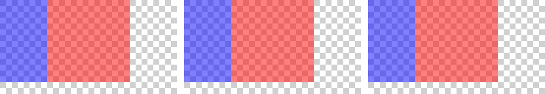
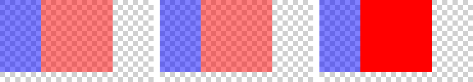

# CMP: an offset child of a `ModulateAlpha` layer

A box with `graphicsLayer(alpha = 0.5f, compositingStrategy = …)`, 220×140, holding a blue 140×140
box and a red 140×140 box moved by `offset(x = 80)`. The documents are written by AndroidX's
creation API (`remote-creation-compose` 1.0.0-alpha24). Each strip shows `Auto`, `Offscreen` and
`ModulateAlpha` from left to right, 300×160 at density 1, over a checkerboard.

The CMP player applied `RcOffsetModifier` as Compose's lambda `Modifier.offset { }`, which places the
child with a layer of its own. On Skiko a `ModulateAlpha` layer fades only its own draw calls
(`SkiaBackedCanvas.alphaMultiplier`) and draws a child layer into the raw canvas at full alpha, so
the offset child came out opaque on the JVM and in the browser. Android's render nodes pass the
alpha on, so AndroidX's player fades it.

The player still places an offset with a layer by default, so an animated offset moves without
redrawing its ancestors. Only under a `ModulateAlpha` layer on Skiko (JVM, Wasm, Apple) is it placed
without one; on Android it always keeps the layer.

| lane | strip |
| --- | --- |
| AndroidX embedded player (Robolectric) |  |
| CMP JVM, before |  |
| CMP JVM, after |  |
| Wasm (Chromium), before |  |
| Wasm (Chromium), after |  |

Before, only the third cell differs from AndroidX: the red box is opaque. After, it is half
transparent in every cell. Where the two boxes overlap, `ModulateAlpha` now fades each draw on its
own, so the blue shows through the red, as in `renders/cmp-compositing-strategy/`. The Robolectric
lane draws that overlap as `Offscreen` would. That is a separate divergence, and this change does
not touch it.

## Known limitation

Only the offset is fixed. Any other child that gets a layer of its own still misses a `ModulateAlpha`
parent's alpha on Skiko and is drawn opaque: a clipped child (`RcClipRectModifier`,
`RcRoundedClipRectModifier`), a scroll container, a nested `RcGraphicsLayerModifier`, a component
offscreen buffer (`RcComponentOffscreen.kt`) and a visibility transition (`RcVisibilityTransition.kt`).
`RcGraphicsLayerCompositingRenderTest.aClippedChildOfAModulateAlphaLayerStillMissesItsAlpha` pins
the clip case as it is drawn today. The cause is in Compose Multiplatform's Skiko `GraphicsLayer`,
not in this player.

## Reproducing

`inputs/` holds the three documents and the harness manifest. They were written on Robolectric
through AndroidX's `captureSingleRemoteDocument` (the `androidxDocument` helper of
`:rc-creation-coexistence-check`) at 300×160 and 160 dpi:

```kotlin
RemoteBox(
  RemoteModifier.graphicsLayer(alpha = 0.5f.rf, compositingStrategy = strategy)
    .size(220.rdp, 140.rdp)
) {
  RemoteBox(RemoteModifier.size(140.rdp).background(Color(0xFF0000FF).rc))
  RemoteBox(RemoteModifier.offset(x = 80.rdp).size(140.rdp).background(Color(0xFFFF0000).rc))
}
```

The AndroidX and CMP lanes read them through the repository's harnesses, given absolute paths:

```sh
./gradlew :third-party-rc-embedded-player:testDebugUnitTest --rerun \
  --tests '*RcEmbeddedRenderHarness*' -Prc.embedded.input=<inputs> -Prc.embedded.output=<dir>
./gradlew :rc-player-compose:jvmTest --rerun \
  --tests '*RcCmpRenderHarness*' -Prc.cmp.input=<inputs> -Prc.cmp.output=<dir>
```

For the Wasm lane, copy the `.rc` files into `:rc-player-wasm:wasmPlayerTestDist`'s output
(`rc-player/wasm/build/wasmTestDist`). Then `tools/wasm-shot.mjs <dist> <out> <id>...` opens
`index.html?src=<id>.rc&handoffDelayMs=0` in Playwright's Chromium and takes a screenshot.
`tools/strip.mjs <out.png> <cell.png>...` lays the cells side by side over the checkerboard. Both
tools use `scripts/wasm-smoke`'s `node_modules` (`npm ci` there first).

The Wasm strips are byte-identical to the CMP ones because the pixels are: both lanes rasterize
with Skia, and every edge here is axis-aligned on whole pixels, so there is nothing for the two
backends to anti-alias differently. Only the PNG encoding of the raw captures differs. The raw
Playwright captures are in `raw/`.

The regression tests are in `RcGraphicsLayerCompositingRenderTest`:
`anOffsetChildIsFadedWithItsParentLayer` covers the fix, and
`anOffsetKeepsItsLayerOutsideAModulateAlphaLayer` checks that the default keeps the layer.
