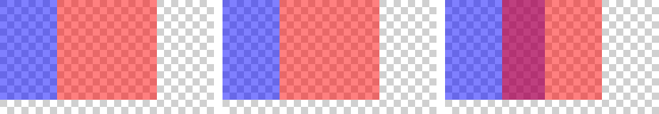

# CMP: an offset child of a `ModulateAlpha` layer

A box with `graphicsLayer(alpha = 0.5f, compositingStrategy = …)`, 220×140, holding a blue 140×140
box and a red 140×140 box moved by `offset(x = 80)`. The documents are written by AndroidX's
creation API (`remote-creation-compose` 1.0.0-alpha24). Each strip shows `Auto`, `Offscreen` and
`ModulateAlpha` from left to right, 300×160 at density 1, over a checkerboard.

The CMP player applied `RcOffsetModifier` as Compose's lambda `Modifier.offset { }`, which places the
child with a layer of its own. On Skiko a `ModulateAlpha` layer fades only its own draw calls
(`SkiaBackedCanvas.alphaMultiplier`) and draws a child layer into the raw canvas at full alpha, so
the offset child came out opaque on the JVM and in the browser. Android's render nodes pass the
alpha on, so AndroidX's player fades it. The player now places an offset without a layer.

| lane | strip |
| --- | --- |
| AndroidX embedded player (Robolectric) |  |
| CMP JVM, before |  |
| CMP JVM, after |  |
| Wasm (Chromium), before |  |
| Wasm (Chromium), after |  |

Before, only the third cell differs from AndroidX: the red box is opaque. After, it is half
transparent in every cell. Where the two boxes overlap, `ModulateAlpha` now fades each draw on its
own, so the blue shows through the red, as in `renders/cmp-compositing-strategy/`. The Robolectric
lane draws that overlap as `Offscreen` would. That is a separate divergence, and this change does
not touch it.

The lanes read the same `.rc` files through the repository's harnesses:

```sh
./gradlew :third-party-rc-embedded-player:testDebugUnitTest --rerun \
  --tests '*RcEmbeddedRenderHarness*' -Prc.embedded.input=<dir> -Prc.embedded.output=<dir>
./gradlew :rc-player-compose:jvmTest --rerun \
  --tests '*RcCmpRenderHarness*' -Prc.cmp.input=<dir> -Prc.cmp.output=<dir>
```

The Wasm lane loads each document into `:rc-player-wasm:wasmPlayerTestDist`'s `index.html` with
`?src=<id>.rc&handoffDelayMs=0` and takes a Playwright screenshot. The regression test is
`RcGraphicsLayerCompositingRenderTest.anOffsetChildIsFadedWithItsParentLayer`.
