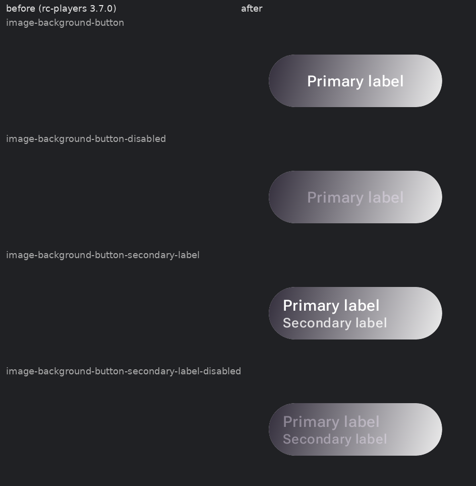
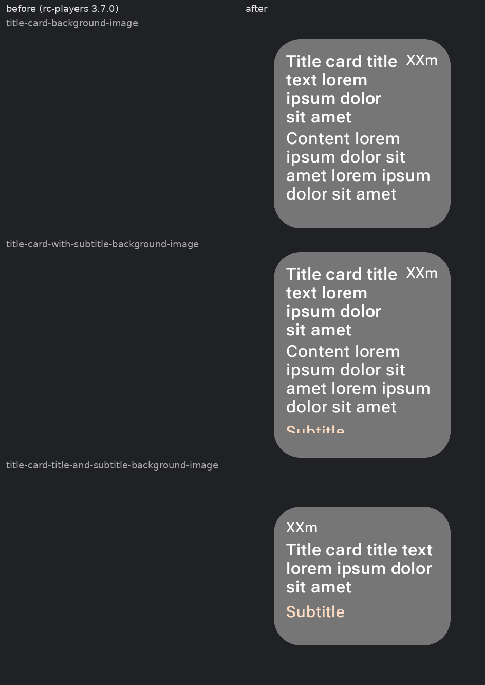

# Embedded player: `ImageAttribute` on a `remote-core` without `getImageId()`

The seven remote-m3-catalog stickers its snapshot lane baked blank, rendered through the vendored
embedded player by `RcEmbeddedRenderHarness` with the test runtime's `androidx.compose.remote` group
forced to the androidx.dev `1.0.0-SNAPSHOT` of build 16639771 (the catalog's
`.github/ci/remote-snapshot-pin`), the player itself still compiled against alpha23 as published.
The documents are the catalog's own `.rc` sidecars from that lane.

**Before** is the catalog's bake from rc-players 3.7.0: a fully transparent frame (shown here on the
sheet's background). The harness fails each one with
`NoSuchMethodError: 'int androidx.compose.remote.core.operations.ImageAttribute.getImageId()'`,
thrown from the draw stream the first time it reaches the op. **After** is this change.

| sticker | drawn pixels before | after |
| --- | ---: | ---: |
| `ImageBackgroundRemoteButton` | 0 | 33539 (36.9%) |
| `…_VARIANT_disabled` | 0 | 33539 (36.9%) |
| `…_VARIANT_secondary-label` | 0 | 33539 (36.9%) |
| `…_VARIANT_secondary-label-disabled` | 0 | 33539 (36.9%) |
| `TitleCardRemote_VARIANT_background-image` | 0 | 124353 (68.5%) |
| `…_VARIANT_with-subtitle-background-image` | 0 | 135361 (74.5%) |
| `…_VARIANT_title-and-subtitle-background-image` | 0 | 90641 (49.9%) |

The after column matches what the same stickers looked like on the catalog's released-core stack
(remote-m3-catalog-out `eb71c1d`). On alpha23, where the getter exists, the player draws exactly
what it did before: the change only adds a path for a core without it.

