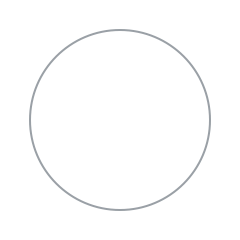
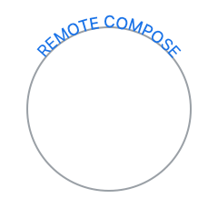
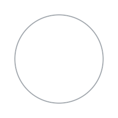
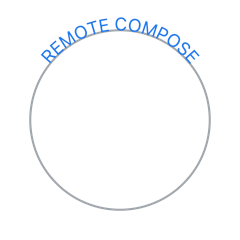
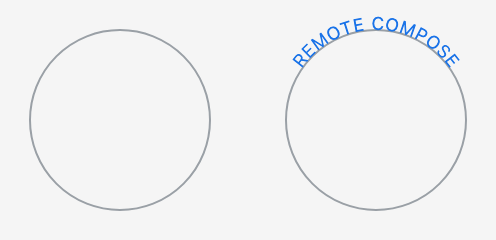

# Native Swift `DrawTextOnCircle` evidence

The dial from the Kotlin player's `RcTextOnCircleRenderTest` evidence strip. It is a grey stroked
circle with "REMOTE COMPOSE" in blue on a `DrawTextOnCircle`, with alignment CENTER and placement
OUTSIDE, pinned at -90°, radius 80 plus warp 10. The document is built byte for byte by
`NativeTestDocuments.textOnCircle(.labelledDial)`.

| Host | Before | After |
| --- | --- | --- |
| AppKit |  |  |
| UIKit (iOS simulator) |  |  |

The Kotlin player drawing the same dial, as a reference (before | after):

How each picture was made:

- **AppKit before:** `rc-swift-render` built at `63f36390` (upstream `main`), drawing the labelled
  dial. It is byte-identical to the AppKit render of the dial without the operation, because the
  operation drew nothing there.
- **UIKit before:** the dial with the operation left out. That is what base UIKit drew for it: the
  canvas switch had no case for the kind, so it fell through to `default: break`.
- **After (both hosts):** `NativeTextOnCircleRenderTests.writesTheEvidencePair`. Run it with
  `RC_TEXT_ON_CIRCLE_OUT=<dir> RC_COMPOSE_PLAYER_NATIVE_ONLY=1 swift test --filter writesTheEvidencePair`
  for AppKit. For UIKit, run it through `xcodebuild test` with
  `TEST_RUNNER_RC_TEXT_ON_CIRCLE_OUT=<dir>`.
- **Kotlin:** `./gradlew :rc-player-compose:jvmTest --rerun --tests '*RcTextOnCircleRenderTest*'
  -Prc.textOnCircle.out=<dir>`.

The glyphs are the hosts' own system fonts (SF on Apple, Skia's default on the JVM), so the
letterforms and their widths differ. The geometry is compared in the tests: per-glyph centre
angles derived from `arcForCircleText` and its glyph walk, and the 36-bucket ring signature of the
Kotlin test's documents.
